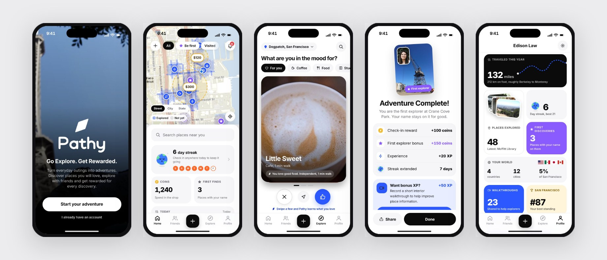
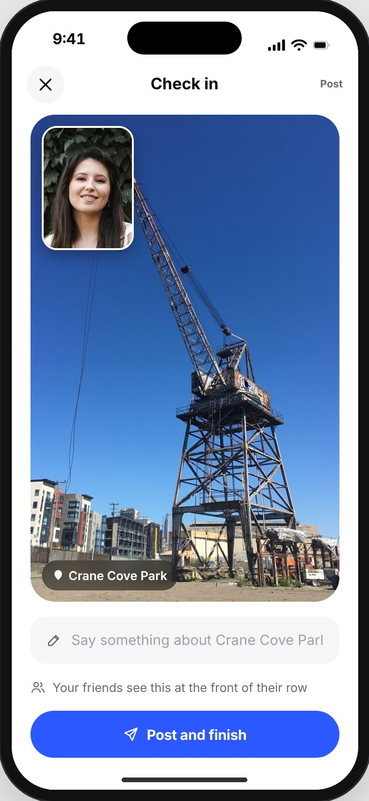
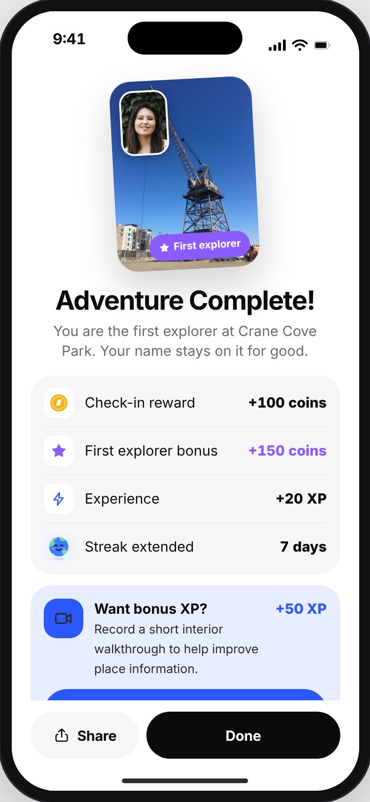
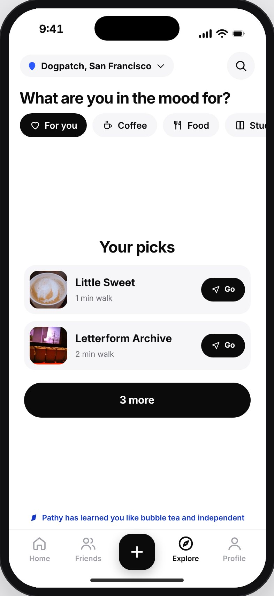
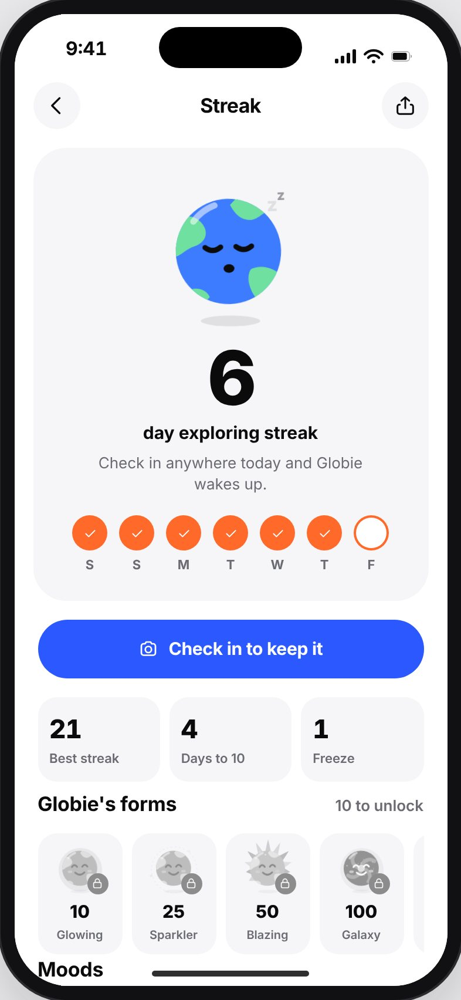
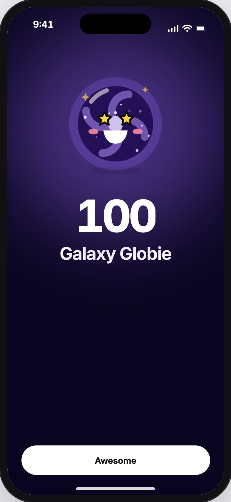
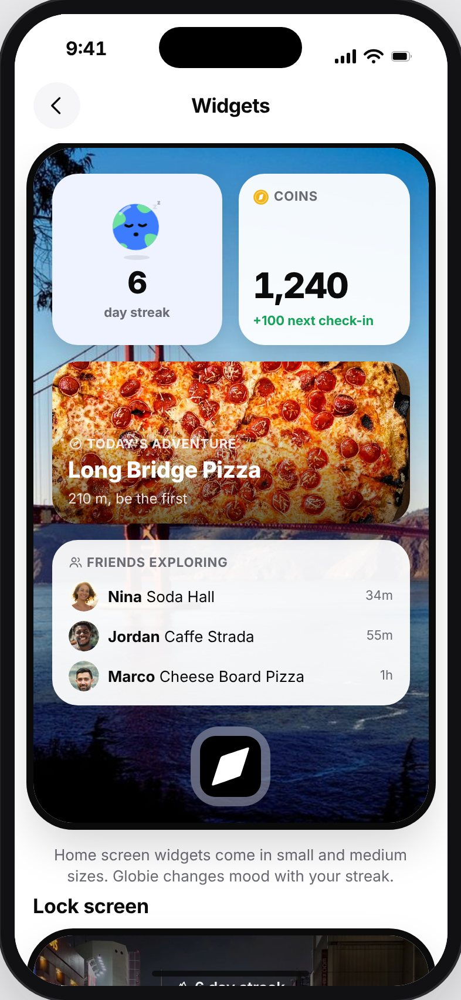
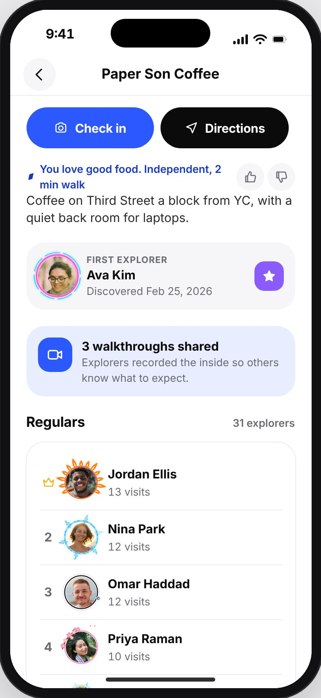
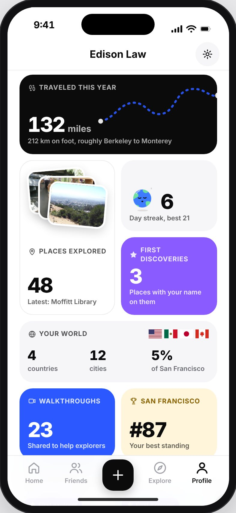
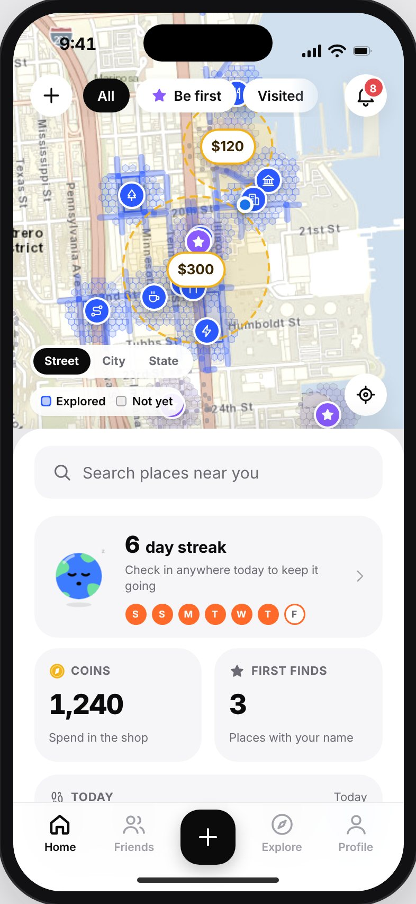

<p align="center">
  
</p>

<h1 align="center">Odyssey for iOS</h1>

<p align="center">
  Turn everyday life into an adventure. Odyssey helps you discover places you'll love, explore with friends, and get rewarded and recognized for every discovery.
</p>

<p align="center">
  
  
  
  
</p>

**Go Explore. Get Rewarded.**

Odyssey makes exploring the world around you exciting, rewarding, and social. Whether you're discovering hidden gems, visiting new places, or simply going somewhere with friends, Odyssey turns every outing into an adventure. It learns what you love to help you discover new places wherever you go, while rewarding you with coins, achievements, and recognition for exploring. Be the first to discover a place, leave your mark, complete challenges, and share your adventures with friends.

Built on five pillars: **Adventure**, **Explore**, **Rewards**, **Recognition** and **Social**.

This repo is the native app: a SwiftUI port of the [clickable mockup](https://github.com/edison16a/Pathy-demo), screen for screen, now with the real camera, real location, home screen widgets and a Live Activity. Everything is stored on the phone for now.

## Screenshots

The app follows the mockup's designs one to one, so these shots of the mockup show what each screen looks like.

<p align="center">
  
</p>

<table>
  <tr>
    <td align="center" width="33%"><br><sub>Check in: the place, then you</sub></td>
    <td align="center" width="33%"><br><sub>Adventure Complete, +100 coins</sub></td>
    <td align="center" width="33%"><br><sub>Three picks at a time, swipe good or bad</sub></td>
  </tr>
  <tr>
    <td align="center" width="33%"><br><sub>Globie's forms and your streak</sub></td>
    <td align="center" width="33%"><br><sub>At 100 days Globie turns into a galaxy</sub></td>
    <td align="center" width="33%"><br><sub>Widgets on the home screen</sub></td>
  </tr>
  <tr>
    <td align="center" width="33%"><br><sub>Place page with the first explorer</sub></td>
    <td align="center" width="33%"><br><sub>Your profile and showcase</sub></td>
    <td align="center" width="33%"><br><sub>Home map with explored zones</sub></td>
  </tr>
</table>

## What is in the app

- **Check in with the real camera.** The back camera takes the place, then it flips to the front for you, BeReal style. Rewards match the mockup: +100 coins and +20 XP, +150 more for the first explorer anywhere on Odyssey, quests on top, and +50 more at a place Explore recommended.
- **The whole world is the map.** Wherever you walk, the hexes of a fixed world grid along your path turn blue, like a footprints map; car rides and GPS jumps do not count, and Settings can keep recording in the background. Walking past a place explores it, but it only becomes yours when you check in with a photo. Every shop, cafe, park and museum around you comes from Apple Maps points of interest and OpenStreetMap together, and when you reach one a card shows which friends have been there with a Check in button. Directions hand off to Apple Maps.
- **Streaks with Globie.** One check-in a day keeps the streak. Every first check-in powers Globie up, and milestones at 10, 25, 50, 100 days and on turn Globie into a new form with a badge, a frame and a banner.
- **3D scans.** The + button films a slow walk through the place you are at (found by GPS). The video goes to Convex, a render computer turns it into a 3D space with the people taken out, and the place lists it as a 3D space: a thumb stick to walk, drag to look. A place can have several spaces, each named by the explorer who filmed it, and only that explorer can rename or delete theirs. While it is being built, the place shows what the render computer is doing.
- **Walkthroughs.** An optional short video after a check-in, recorded with consent. The phone reads a few frames with Apple's Vision framework to learn whether a place feels quiet or lively, which feeds recommendations.
- **Explore.** An endless deck of picks ranked by your taste, with All, Be first, Close by, a category menu and a search bar that suggests from over a thousand things to do and eat. Swipe right or left and Odyssey learns your taste; star a place to pin it on your map. What Odyssey knows about you has its own page.
- **Business bounties.** Businesses post a pool for walkthroughs of a place or an area, paid per video or split evenly; explorers see them in the feed and on the map and get paid in bounty cash, which also buys gift cards.
- **Ranks and leaderboards.** Six rank emblems, each with its own shape in its tier color, a full screen rank up moment, and gold and silver laurels, badges and banners for reaching the top 10 and top 100 of a board.
- **Recognition and travel.** The Globe's year in review with your explorer twin, the explored map that lights up along every trail you walk, the arrival scene for a new country, engraved explorer portraits, ranks and leaderboards.
- **Seasons and quests.** The Winter Wonderland season with its exclusive title, mega quests, rarity quests with friend invites, and the press and hold reveal of today's adventure.
- **Friends, stories, profile, shop, recaps and gift cards**, plus the landing montage, reward pops after small wins and a demo guide in Settings that jumps to any flow. Admin in Settings edits your stats, opens any scene, resets data and turns on demo mode, where checking in at Y Combinator ranks you up and lands you in the top 10.

## Widgets and the Live Activity

| Widget | Sizes | What it shows |
|---|---|---|
| Streak | Small, medium, Lock Screen circle, Lock Screen, above the clock | Globie in your current form and mood, the count, this week |
| Today's Adventure | Small, medium, large, Lock Screen | Today's pick with its photo, distance and the coins waiting |
| Coins and Rank | Small, Lock Screen circle, Lock Screen | Your balance and progress to the next rank |
| Friends Exploring | Medium, large | Who checked in where, and how long ago |
| Quest | Small, medium, Lock Screen | The rarest open quest near you and its reward |
| Leaderboard | Small, medium, large, Lock Screen | Your friends board for the week with a podium, and your city standing |

The **Widgets** section on the profile tab shows live previews of all of them. Each one has an editor for its style (light, dark, your streak form's colors, or a photo) and details, and changes reach the home screen right away. iOS only lets people place widgets themselves, so the app walks through adding them.

The **adventure Live Activity** starts when you head to a place. It counts the distance down on the Lock Screen and in the Dynamic Island around the camera, switches to "You're here" when you arrive, and shows the coins and streak once you check in. The widgets gallery has a button to try it with today's adventure.

## 3D scans

A scan goes phone, Convex, render computer, Convex, phone. Nothing talks to the phone directly.

1. **Phone.** `Odyssey/Features/Scan` records with the 0.5x camera (or takes a video from the library), re-encodes it as 1080p HEVC, uploads it to Convex storage and creates a row in `scans`.
2. **Convex.** `convex/scans.ts` holds the queue and each scan's status, message and progress.
3. **Render computer.** `tools/scan-worker/worker.py` runs on a Mac with Apple silicon. It claims the next scan, takes 6 frames a second from the video, masks out people (Apple Vision), solves the camera path (COLMAP), trains a Gaussian splat (Brush), levels the floor and uploads a 10 MB model. A 90 second video takes about 15 minutes.
4. **Phone.** The place lists the space by its name. The model is downloaded once and drawn by a small WebGL page inside the app.

Run a render computer:

```
brew install ffmpeg colmap
python3 tools/scan-worker/worker.py
```

Scans currently live on their own Convex dev deployment (`ScanConfig` in `ScanService.swift`, `CONVEX_URL` in the worker), because two people pushing to one dev deployment overwrite each other's functions. Once `convex/scans.ts` is deployed with everything else, point both at the main deployment.

Filming tips that decide whether a scan works: walk slowly, turn slowly (a quick turn is where the 3D build loses track and everything after it is dropped), and film the room rather than people.

## Getting started

1. Open `Odyssey.xcodeproj` in Xcode 26 or later.
2. Pick your team under Signing and Capabilities for the **Odyssey** and **OdysseyWidgetsExtension** targets. Both use the App Group `group.com.edisonlaw.Odyssey`; if Xcode asks, let it register the group.
3. Run on an iPhone to use the camera. The simulator works too: check-ins fall back to the place photo and a sample selfie, and you can set a simulated location from the Debug menu.

Run the tests with Product, Test. They check the port against numbers computed from the mockup's JavaScript.

## Project structure

```
Odyssey/
  App/             Entry point, router with odyssey:// links, tab shell
  Core/            Theme, icons, formatting
  Models/          Codable models for the seed data
  Store/           App state and the services ported from the mockup
  Services/        Location, nearby places, camera, widgets, Live Activity
  UI/              Photos, avatars, frames, thumbs, toasts, confetti
  Features/        One folder per screen or flow
  Resources/       seed.json, the landing montage and SVG art exported from the mockup
  Media.xcassets   Every photo the seed data points at
Shared/            Code both targets compile: palette, Globie, widget views
OdysseyWidgets/      The widget extension and the Live Activity
Config/            Info.plist additions and entitlements
OdysseyTests/        Unit tests
tools/             Seed export, asset catalog and project scripts
```

## How it works

- **One store.** `AppStore` is an `@Observable` object holding the whole app state, the same shape as the mockup's. Every change saves a JSON file in the App Group and refreshes the widgets.
- **Same data and art as the mockup.** `tools/export-seed.mjs` runs the mockup's data scripts and writes `seed.json`; `tools/build-assets.py` copies every photo it references into `Media.xcassets`; `tools/export-art.mjs` saves the engraved portraits and arrival art as SVG, drawn in the app exactly as authored. Rewards, taste learning, seeded place history and hashing are ported number for number, and the tests compare against the browser.
- **Widgets.** `WidgetBridge` writes a small snapshot (streak, coins, today's pick, friends, the next quest) plus the photos the widgets need into the App Group, then reloads them. The extension only reads it.
- **Tech stack.** SwiftUI on the phone today. [`docs/TECH-STACK.md`](docs/TECH-STACK.md) has the plan for Convex and Supermemory.

## Credits and license

Place and category photos are openly licensed works from Flickr and Wikimedia Commons, and portraits come from Unsplash. Every source and license is listed in [`docs/CREDITS.md`](docs/CREDITS.md). Place data is © OpenStreetMap contributors and Apple Maps. Names of people in the demo are fictional.

The code is released under the [MIT License](LICENSE). Media files keep their own licenses.
